# Arc

Save everything we can from the Arc browser before it sunsets (Arc's own farewell banner gives **December 22, 2026**).

This repo is a field guide to how Arc for macOS (1.174.0, build 91305, Chromium 158.0.8127.37) is built and how it works, reverse-engineered from the shipping app. It also has scripts to archive the app and back up your own Arc data before it's gone.

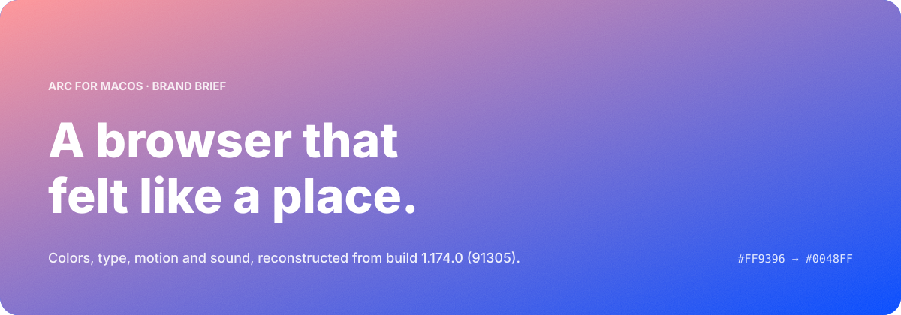

## Brand brief

Arc's look comes down to one idea: **the browser takes on the color of where you are.** Each Space has its own color, the chrome is mostly see-through so that color fills the whole window, and the content sits on top as a clean white card. The rest of the system is warm, a little playful, and very consistent.

| | |
|---|---|
| **Signature** | The peach-to-electric-blue gradient `#FF9396 → #0048FF`, used for the welcome screens, Capture and the brand marks |
| **Accent** | Arc Blue `#3139FB`: primary buttons, focus, checkboxes, selection. It appears in 21 color slots |
| **Surfaces** | Cool off-white `#FAFBFF` popovers and near-black ink `#0E0F10`. Dark mode uses deep navies (`#120F2E`, `#151C30`), not grays |
| **Chrome** | Sidebar items have no solid fill, only white or ink at 5–85% opacity, so the Space color shows through |
| **Texture** | Space backgrounds get a film-grain overlay (grain, sand, denim or tweed) drawn by Metal shaders |
| **Type** | The system font (SF Pro) for the browser UI. Easels pair Space Mono, EB Garamond, Inter and SF. 83 fonts in total, including Dinamo, Grilli and Klim display faces |
| **Motion** | Seven named springs (`firm` … `springyExtraFast`) and 12 Lottie animations that recolor to match the Space |
| **Voice** | Friendly and slightly cheeky ("Tidy Tabs", "Little Arc", "Boosts", "Easels") |

### The window is the Space

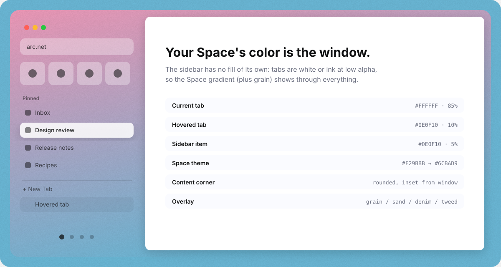

When you pick a Space color, Arc derives a 4-tone palette from it (`tintedLight`, `midTone`, `shaded`, `shadedDark`) plus a 12-role light/dark palette for text, focus, hover and backgrounds. You can mix it as a single color or a gradient (`complimentary` / `analogous`), and adjust noise and intensity. The full model is in [design-system.md §2](docs/design-system.md#2-space-theming).

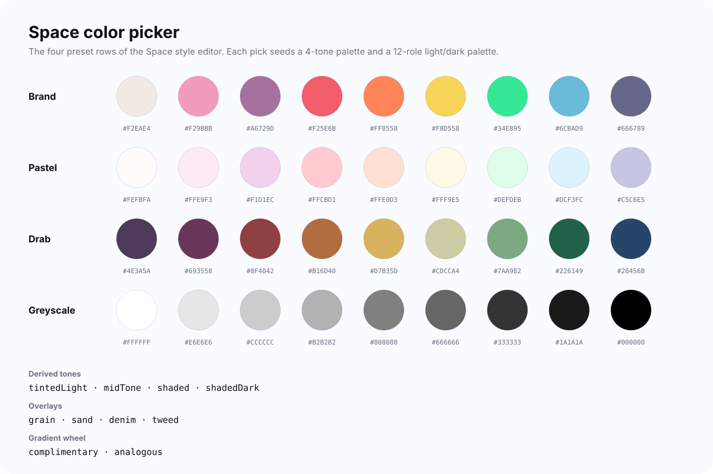

### Color

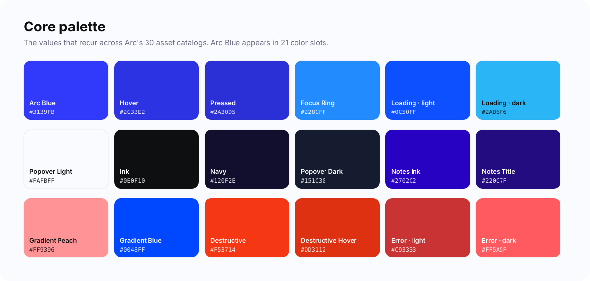

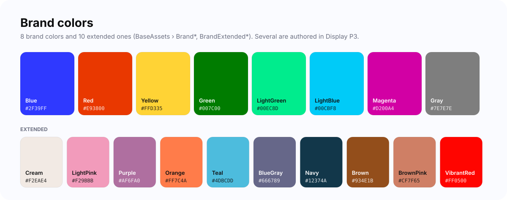

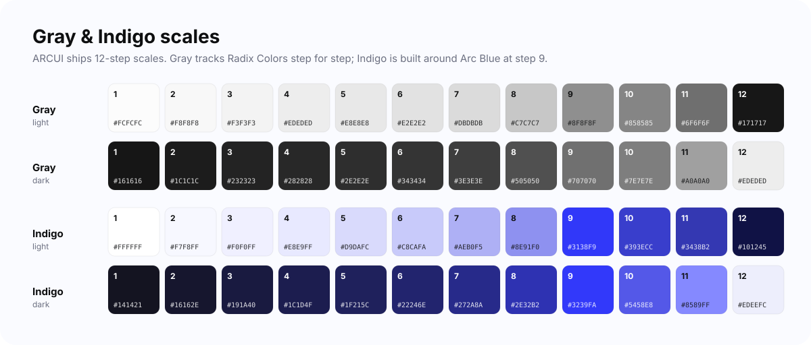

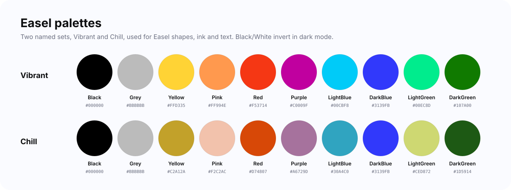

All 519 named colors (light and dark) are in [docs/design-tokens.json](docs/design-tokens.json).

### Type

The browser UI uses the system font, so Arc's typographic personality comes through in Easels, onboarding and the membership card. Easels offer four text styles, each with its own font and line height:

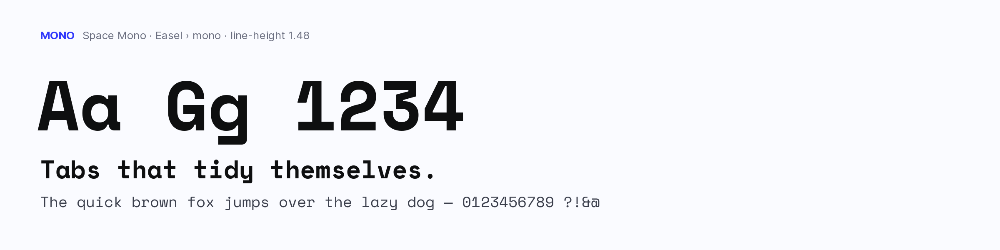
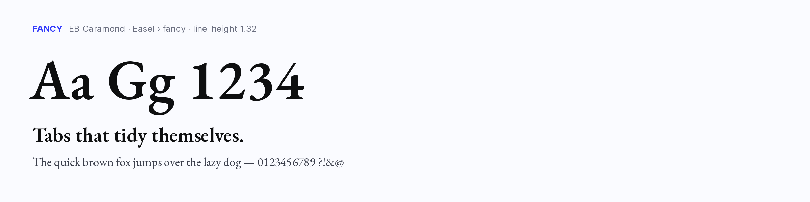
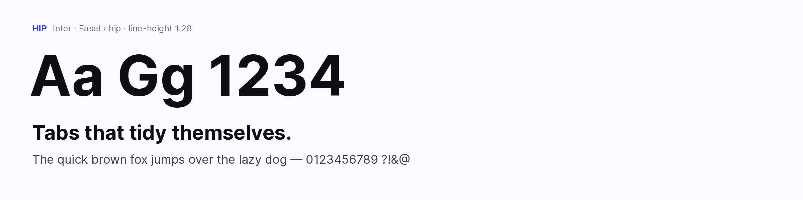
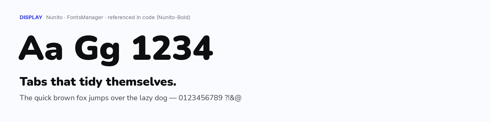
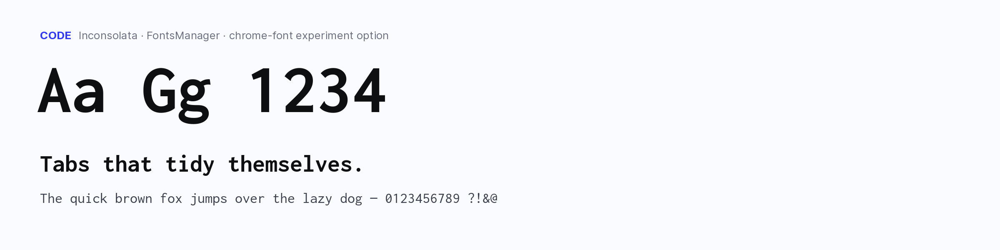

| Style | Font | Ultra / H0 / H1 / H2 / Body (pt) | Line height |
|---|---|---|---:|
| `mono` | Space Mono | 80 · 60 · 44 · 24 · 15 | 1.48 |
| `fancy` | EB Garamond | 80 · 60 · 48 · 28 · 16 | 1.32 |
| `hip` | Inter (900) | 80 · 60 · 44 · 21 · 18 | 1.28 |
| `clean` | SF Pro (800) | 80 · 60 · 44 · 24 · 15 | 1.2 |

Arc also bundles commercial display families, listed here by name only: **ABC Favorit** (+ Lining, Mono) and **ABC Oracle** by Dinamo, **GT Ultra** by Grilli Type, **Marlin Soft / Soft SQ** by Fontmesa, and **Pitch**, **Pitch Sans**, **Söhne Breit**, **National 2** and **Söhne** by Klim. There are two icon fonts: Feather (286 glyphs) and Ionicons (1,181). The specimens above use only the open-source (SIL OFL) fonts.

### Iconography

- **414 images** across 46 asset catalogs, 118 of them template icons that are tinted at runtime.
- **Alternate app icons:** Original, Canary, Candy, Colorful, Neon, Hologram, Fluted Glass, Schoolbook, Early Birds, Dev. Five Dia app icons ship too.
- **Integration marks** for the Command Bar and Live Folders: Google Workspace, Notion, Linear, Jira, GitHub, Slack, Figma, ChatGPT, Claude and others.
- **4,491 SF Symbols mapped to emoji** for Space and folder icons, plus 61 Ionicons glyphs in the sidebar icon picker.

The icons are The Browser Company's artwork, so they aren't reproduced here. `scripts/extract-app.sh` followed by `scripts/tools/brand_book.py vault` builds a local page with all of them (see below).

### Motion & sound

| Animation | Where | Canvas | Length |
|---|---|---|---:|
| `logo-wave` | Animated Arc logo stroke | 225² | 3.0 s |
| `archive` · `boosts` · `downloads` · `easels` · `screenshots` · `spaces` | Home / Library icons; layers named `primaryColor`/`secondaryColor` so they recolor per Space | 128² | 1–2 s |
| `sun` · `moon` · `automatic` | Space style editor light/dark toggle | 500² | 1–1.5 s |
| `update-heart-animation` | "Arc updated" sidebar banner | 350² | 2.0 s |
| `smiley` | Settings | 100² | 5.0 s |

Springs: `firm`, `firmSlow`, `firmExtraSlow`, `firmFast`, `springy`, `springyFast`, `springyExtraFast`, all driven by Arc's own display-link spring, decay and bezier engine. There are only three sounds: the Capture shutter, an `event` chime, and 21 seconds of onboarding music.

### See everything locally

```bash
scripts/extract-app.sh                    # unpack Arc.app into vault/
python3 scripts/tools/brand_book.py vault # -> vault/brand-book.html
open vault/brand-book.html
```

The local brand book is an editorial portfolio wall: warm paper, Arc's own EB Garamond with a peach-to-blue italic, tabs with counts, and every piece as a poster tile you can click to enlarge. The tabs are Highlights, Color, Spaces (a live Space picker), Icons (all ten app icons plus Dia's), Illustrations, Type (18 families set in Arc's bundled fonts, with a live tester), Glyphs (searchable), Motion (Arc's Lottie animations plus original studies: kinetic type rings, a halftone "Arc", particle fields, Tidy Tabs and the Command Bar in motion) and Sound & Video. It stays in `vault/` because it shows Arc's copyrighted artwork. The boards on this page are redrawn from token values by `scripts/tools/brand_board.py`.

## What's here

| Doc | What it covers |
|---|---|
| [docs/architecture.md](docs/architecture.md) | How Arc is built: a Swift/AppKit/SwiftUI app that *is* the Chromium browser process (ArcCore.framework), about 235 first-party modules, The Composable Architecture, `swift-dependencies` clients, the Swift↔Chromium bridge, ADK, persistence, AI layering, third-party stack, signing |
| [docs/features.md](docs/features.md) | How each feature works internally: Spaces, sidebar, auto-archive, Split View, tab groups, Little Arc, Peek, Command Bar, Air Traffic Control, Boosts, Easels, Notes, Live Folders, Arc Max / Browse for Me, PiP, ad blocking, AppleScript, … |
| [docs/data-model.md](docs/data-model.md) | Every `Storable*.json` file Arc writes, the sidebar item graph, Swift Codable encoding quirks, window themes, profiles, and sync (CloudKit to end-to-end-encrypted Firestore) |
| [docs/design-system.md](docs/design-system.md) | Colors (519 light/dark tokens), Space theming and its Metal pipeline, typography, icon inventory, motion (springs and Lottie), sound, ARCUI components |
| [docs/design-tokens.json](docs/design-tokens.json) | Machine-readable color, font and motion tokens |
| [docs/services-and-flags.md](docs/services-and-flags.md) | Backend hosts, integrations, all 243 feature flags, telemetry, internal URLs, and what breaks when the servers shut down |

## Scripts

```bash
brew install blacktop/tap/ipsw          # Swift/ObjC interface dumper
python3 -m pip install brotli           # for Chromium .pak resources

scripts/extract-app.sh                  # archive + take apart /Applications/Arc.app
scripts/backup-user-data.sh             # back up YOUR Arc data (quit Arc first)
```

- **`extract-app.sh`** copies the signed app and extracts reconstructed Swift/ObjC interfaces, binary strings, every asset catalog (images as PNG/PDF, named colors as light/dark JSON), fonts, Lottie animations, sounds, videos, all localizations, Chromium `.pak` resources and Arc's custom mojom interfaces.
- **`backup-user-data.sh`** copies `~/Library/Application Support/Arc` (minus regenerable caches) and Arc's preferences. It then exports:
  - `bookmarks.html`: your favorites, Spaces, pinned tabs, folders, archived tabs, and tabs recovered from Arc's rolling sidebar snapshots. It imports into Chrome, Dia, Zen, Firefox, Safari, Brave and others.
  - `sidebar.json` / `sidebar.md`: the same tree, readable.
  - Per profile: Chromium bookmarks, `history.csv`, and the installed extensions with their Web Store links.
- Tools in `scripts/tools/`: `car_extract.swift` (asset catalogs via public AppKit APIs), `pak_extract.py` (Chromium paks), `export_sidebar.py` (Arc sidebar to bookmarks).

All output goes to **`vault/`, which is gitignored and never committed.**

## What is deliberately *not* in this repo

- **Arc itself:** binaries, icons, fonts, animations, sounds, strings. These are The Browser Company's copyrighted material. The scripts rebuild them locally from your own installed copy, and the docs describe them by name and value only.
- **Personal data:** tabs, history, cookies, accounts, sync state. `vault/user-data/` stays on your machine.
- **Secrets:** every API key, token and DSN found in the binary is written as `<redacted>`.

## Before Arc goes away: checklist

1. Quit Arc and run `scripts/backup-user-data.sh`.
2. **Passwords** stay encrypted with the "Arc Safe Storage" Keychain key, so the backup alone can't move them. Export them in Arc (Settings > Passwords, or `chrome://password-manager`) and import the CSV into your next browser.
3. **Boosts, Easels and Notes live in Arc's cloud** (Firestore and Firebase Storage), not in local files. Use Arc's built-in export options (Export All Easels, Notes export to zip) and copy the code of any Boost you care about.
4. Keep `vault/app/Arc-1.174.0-91305.app`. It's a pristine copy of the last build in case auto-update or removal replaces the installed one.
