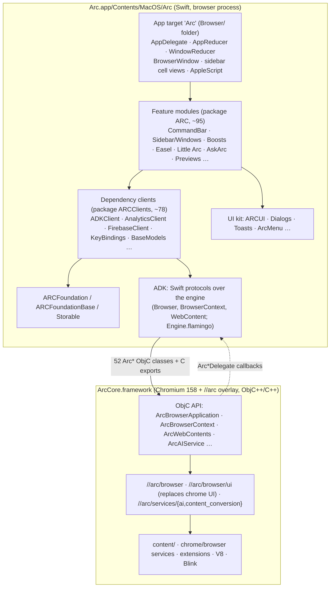
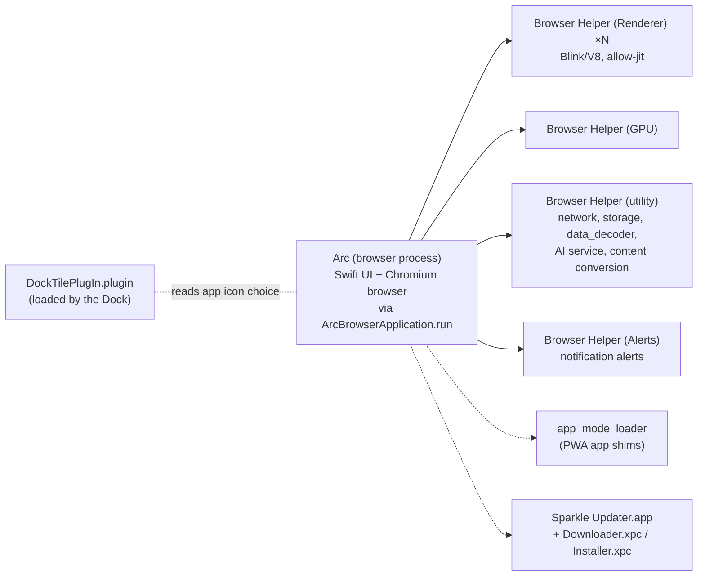
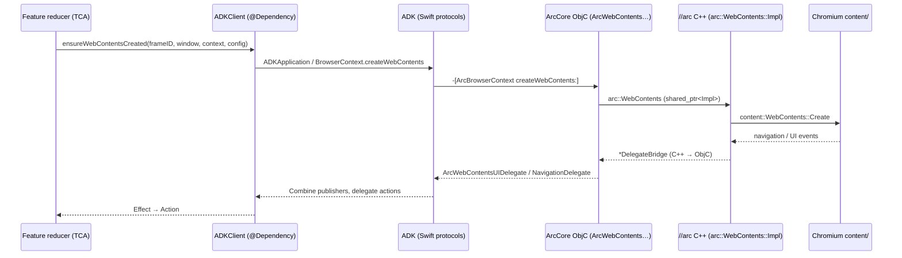
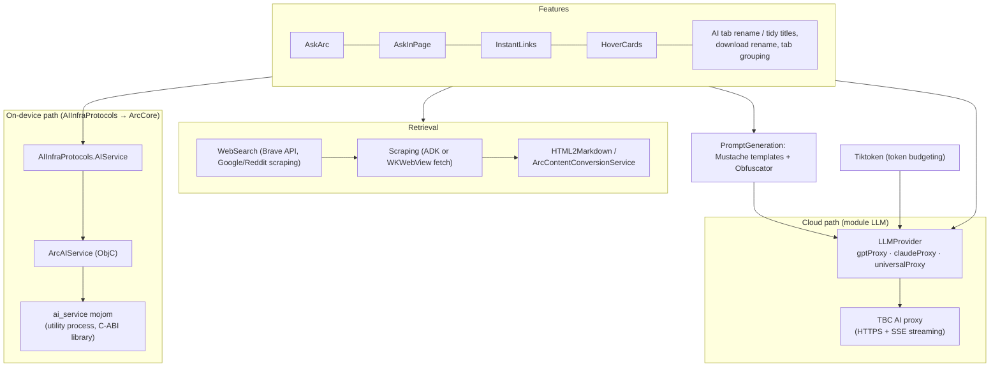

# How Arc is built

An architecture reconstruction of **Arc for macOS 1.174.0 (build 91305)**, The Browser Company's Chromium-based browser, made from a local reverse-engineering extraction of the shipped app bundle. Arc is being sunset, so this document records how it was put together for anyone who wants to build something like it.

> **Provenance and confidence.** Everything here comes from static artifacts: reconstructed Swift type metadata (`ipsw swift-dump`), Objective-C class dumps, Mach-O load commands, `Info.plist`/entitlements, mojom-generated headers, resource bundles and printable strings. No source code was available, and the private user profile was not used. Method bodies are stripped, so behaviour is inferred from type shapes, names and strings. Statements marked **(inferred)** are reasoned guesses. Everything else can be traced to an artifact named in the text. Paths such as `vault/extracted/...` are relative to this repo, and `Arc.app/Contents/...` is relative to the installed app. Secrets found in the binary (API keys, DSNs, SDK keys) are deliberately left out.

---

## 1. At a glance

| Fact | Value | Source |
|---|---|---|
| Bundle id / version | `company.thebrowser.Browser`, 1.174.0 (91305) | `meta/Info.json` |
| Commit tag | `Release-91305-<sha>` (`BCNYCommitInfo`), release type `Release` | `meta/Info.json` |
| Principal class | `Arc.BrowserApp` (an `NSApplication` subclass) | `NSPrincipalClass` |
| Engine | `ArcCore.framework`, Chromium **158.0.8127.37** (`branch-heads/8127`) | `meta/ArcCore-Info.json` |
| Languages | Swift (app, ~250k lines of recovered declarations), ObjC++/C++ (ArcCore) | `swift/Arc.swift`, `swift/ArcCore.objc.h` |
| UI | AppKit shell plus SwiftUI (845 `SwiftUI.View` conformances, 191 `NSView` subclasses, 144 `NSViewRepresentable`) | `swift/Arc.swift` |
| State management | The Composable Architecture (TCA 1.x, `ViewStore` era), 154 `Reducer` conformances | `swift/Arc.swift` |
| Dependency injection | `swift-dependencies`, 160 `DependencyKey` conformances | `swift/Arc.swift` |
| Swift modules in main binary | ~300 (≈235 first-party, ≈65 third-party) | `swift/Arc.swift` |
| Architectures | Universal `x86_64` + `arm64` (app, ArcCore, libaperitif) | `meta/architectures.txt` |
| Min OS | macOS 13.0 | `LSMinimumSystemVersion` |
| Size | `MacOS/Arc` ≈160 MB, `ArcCore` ≈490 MB, whole bundle ≈890 MB | `du` on `Arc.app` |
| Updates | Sparkle 2 (`SUFeedURL` = `releases.arc.net/updates.xml`, EdDSA-signed, checks every 8 h) | `meta/Info.json` |
| Signing | Developer ID, Team `S6N382Y83G`, hardened runtime, **not sandboxed** | `meta/codesign.txt`, `meta/entitlements.json` |

---

## 2. The big picture

Arc is a **native Swift/AppKit app that embeds Chromium as a library**. It does not use Chrome's own UI at all. The Chromium browser process runs inside the `Arc` executable. Chromium's `chrome/browser/ui` layer has been replaced by an `//arc` source overlay that forwards every UI decision (dialogs, permission prompts, context menus, tab creation, full screen, and so on) back to Swift through ObjC delegate protocols.



### 2.1 ArcCore.framework

`ArcCore` (`company.thebrowser.browser.framework`, version string `158.0.8127.37`) is a Chromium build. Its embedded `SCMRevision` is an upstream Chromium branch-head revision. On top of that build, The Browser Company added a top-level `//arc` directory. Source-file strings in the binary show its layout (paths are relative to the Chromium `src/` root):

| `//arc` subtree | What it holds (from file names) |
|---|---|
| `arc/browser/` | `browser_application_impl.cc`, `browser_impl.cc`, `arc_browser_runner.cc`, `arc_content_browser_client.cc`, `history_manager.cc`, `local_state_impl.cc`, `tracing_controller_impl.cc`, `network_activity_monitor_impl.cc`, `ai_service_impl.cc`, `content_conversion_service_impl.cc` |
| `arc/browser/ui/` (~90 files) | Re-implementations of Chrome UI entry points: `browser_dialogs.cc`, `permission_prompt_impl.cc`, `javascript_*_dialog_*`, `location_bar.cc`, `sad_tab.cc`, `extension_install_prompt.cc`, `status_tray.cc`, `profile_picker.cc`, `side_panel_ui.cc`, autofill/password popups and others |
| `arc/browser/web_contents/` | `web_contents_impl.cc`, `navigation_controller_impl.cc`, `devtools_impl.cc`, `devtools_protocol_wrapper.cc`, `media_session_impl.cc`, `pdf_controller_impl.cc`, `thumbnails_generator_impl.cc`, `page_node_observer.cc` |
| `arc/browser/browser_context/` | `browser_context_impl.cc`, `downloads_impl.cc`, `extensions_impl.cc`, `preferences_impl.cc`, `effects_impl.cc` |
| `arc/browser/extensions/` | `arc_extensions_browser_client.cc`, a private `feature_flags_private` extension API, `sentry_tunnel_url_loader.cc` |
| `arc/browser/objcpp/`, `arc/browser/public/` | The ObjC++ façade (`ArcError.mm` and others) and public C++ value types |
| `arc/renderer/` | `ad_blocker_agent.cc`, `render_frame_agent_impl.cc` (renderer-side hooks) |
| `arc/blink/core/` | `top_band_color_tracker.cc` (feeds the toolbar tint, see `TopBarColorClient`) |
| `arc/components/` | `ad_blocker`, `arc_feature_list`, `feature_config`, `crash` |
| `arc/services/` | `ai/ai_service.cc`, `content_conversion/content_conversion_service.cc`, `data_decoder/heif_decoder_service_mac.cc` |
| `arc/third_party/platform_media/` | `ffmpeg/audiotoolboxdec.c`, `ffmpeg/ffviv_audio_kit.c`. The names match Vivaldi's open-source `platform_media` patches, which use Apple's AudioToolbox to decode proprietary codecs **(inferred)** |

### 2.2 libaperitif.dylib and the "Aperitif" helpers

`ArcCore.framework/Versions/A/Libraries/libaperitif.dylib` is tiny. It exports a single symbol, `_AperitifCheckInitialized`, and links only `libsandbox` and `libSystem` (`meta/linked-libaperitif.dylib.txt`). Its strings (`strings/libaperitif.txt`) are about:

- creating a **seatbelt sandbox server** and applying a serialized sandbox policy (`SandboxSerializer`, `--seatbelt-client=`, `org.chromium.sandbox`);
- registering **PartitionAlloc's default malloc zone** ("The PartitionAlloc default zone has unexpectedly already been registered").

There are two helper sets in `ArcCore.framework/Versions/A/Helpers/`:

| Helper | Links | Entitlements |
|---|---|---|
| `Browser Helper`, `(GPU)`, `(Renderer)`, `(Alerts)` | only `libsandbox`. Contains the string `../../../../ArcCore` and `ChromeMain`, so it loads the framework at runtime | base helper: `cs.disable-library-validation`; GPU/Renderer: `cs.allow-jit` |
| `Browser Helper (Aperitif)`, `(Aperitif GPU)`, `(Aperitif Renderer)`, `(Aperitif Alerts)` | **load-time links** `@loader_path/../../../../Libraries/libaperitif.dylib` *and* `../../../../ArcCore` | same pattern |

ArcCore contains a Chromium `base::Feature` string `kAperitifHelpers`. It sits next to upstream content features, so this looks like an **upstream Chromium experiment** and not something Arc-specific **(inferred)**. The name ("an aperitif is served before the meal") and the contents suggest that `libaperitif` runs *before* the 490 MB framework's static initializers. It installs the sandbox and the PartitionAlloc malloc zone as early as possible, and the helper then hands off to `ChromeMain`. All helpers set `LSEnvironment.MallocNanoZone = 0`, which PartitionAlloc requires.

### 2.3 Process model



- **Browser process = `Arc`.** The Swift app instantiates `ArcBrowserApplication`, calls `initialize:`/`run`, and Chromium's browser main loop runs inside the AppKit app. The main binary does *not* import `ChromeMain`. That export is used by the helpers. `Arc.BrowserApp` inherits from Sentry's `SentryCrashExceptionApplication` (through `InstrumentedBrowserApp`) and adopts Chromium's `CrAppProtocol`/`CrAppControlProtocol`, which Chromium requires of the host `NSApplication` (`swift/Arc.objc.h`).
- **Utility services.** Memory metrics have an "ai" bucket (`aiServiceMemoryFootprintMb`, `averageAIServiceCpuPercent` in `strings/Arc.txt`), which places the Arc AI service in its own process (see §8).
- **`app_mode_loader`** and the `ChromeAppModeStart_v8` / `ChromeWebAppShortcutCopierMain` exports are Chromium's installable-web-app shim machinery.
- **`DockTilePlugIn.plugin`** (`company.thebrowser.Browser.DockTilePlugIn`) draws the user's chosen alternate app icon (`AppIconEarlyBirds`, `AppIconFlutedGlass`, `AppIconSchoolbook`, …) in the Dock even while Arc is not running.
- **Sparkle** ships `Updater.app` and `Downloader.xpc`/`Installer.xpc`. Arc puts its own UI on top (`SoftwareUpdaterClient.CustomUserDriver`, `DowngradableVersionComparison`).

### 2.4 Bundle layout

```
Arc.app/Contents/
├── MacOS/Arc                         Swift app + statically linked Swift packages
├── Frameworks/
│   ├── ArcCore.framework/            Chromium (Helpers/, Libraries/libaperitif.dylib,
│   │                                 libvulkan + SwiftShader, Resources/*.pak, icudtl.dat, v8 snapshots)
│   ├── Lottie.framework  Sparkle.framework   (real dynamic frameworks)
│   ├── Sentry / FirebaseFirestoreInternal / grpc / grpcpp / absl / openssl_grpc .framework
│   │                                 ~100 KB stubs; the code is linked statically into MacOS/Arc
│   └── libswiftCompatibilitySpan.dylib
├── PlugIns/DockTilePlugIn.plugin
└── Resources/  144 entries: <Package>_<Module>.bundle SwiftPM resource bundles, MainMenu.nib, Arc.sdef, Fonts/
```

`MacOS/Arc` links only three non-system images: ArcCore, Lottie and Sparkle (`meta/linked-Arc.txt`). The Sentry/Firebase/gRPC framework directories hold placeholder binaries of about 100 KB. Their Swift and ObjC symbols (for example `sentry-cocoa/Sources/...` paths, `Firebase*` types) are inside the main executable, so those dependencies are statically linked.

---

## 3. Code organization

### 3.1 Monorepo layout (reconstructed from build paths)

The binary embeds source paths from a GitHub Actions self-hosted runner (`…/actions-runner/_work/arc/arc/`). Together with the resource bundle names they show this layout:

```
arc/                                  (repo root)
├── Browser/                          Xcode app target → Swift module "Arc"
│   ├── Application/                  AppDelegate.swift, MainWindowController.swift,
│   │   └── Store/                    AppReducer.swift, AppState+*.swift (Sync, Windows, AutoUpdate, …)
│   ├── Windows/                      BrowserWindow.swift, WindowViewController.swift
│   │   └── Store/                    WindowReducer.swift, WindowsState.swift, WindowState+*.swift (~30 slices)
│   ├── WindowContent/                WindowContentViewController(+State/+Menu).swift, WebContentViewController.swift
│   ├── Sidebar/SidebarCells/         TabCellView.swift, TabCellState.swift, EaselCellState.swift, …
│   ├── AppleScript/                  AppDelegate+Applescript.swift  (+ Arc.sdef)
│   └── DataStore/, Debugging/, PictureInPicture/, CommandBar/
├── Frameworks/                       local Swift packages
│   ├── ARC/Sources/<Module>/         ~95 feature modules       → ARC_<Module>.bundle
│   ├── ARCClients/Sources/<Module>/  ~78 client/model modules  → ARCClients_<Module>.bundle
│   ├── ARCFoundation/Sources/        ARCFoundation, ARCFoundationBase
│   ├── ARCUI/Sources/ARCUI/          shared UI kit (UI_macOS/…)
│   └── ADK/Sources/ADK/              engine abstraction
└── Stage/SourcePackages/checkouts/   resolved SwiftPM dependencies (TCA, swift-dependencies, …)
```

Every module is a SwiftPM target and is compiled statically into `MacOS/Arc`. Targets that have resources get a `<Package>_<Target>.bundle` in `Resources/` (for example `ARC_CommandBar.bundle`, `ARCUI_ARCUI.bundle`, `ADK_ADK.bundle`). The same naming convention exposes third-party packages (`LaunchDarkly_LaunchDarkly`, `Firebase_FirebaseFirestore`, `swift-crypto_Crypto`, `Settings_Settings`, …).

Source file names follow a consistent client convention: `XClient.swift`, `XClient+LiveValue.swift` / `+Live.swift`, `XClient+Dependencies.swift`, `Mock.swift`. There are 19 `+Dependencies.swift`, 14 `+Live.swift` and 11 `+LiveValue.swift` files in `strings/Arc.txt`.

### 3.2 Module map

The counts are the number of type declarations (including nested types) per module in `swift/Arc.swift`. Pkg: **A** = `ARC`, **C** = `ARCClients`, **F** = `ARCFoundation`, **U** = `ARCUI`, **K** = `ADK`, **App** = app target. **?** means the module is first-party by naming and dependencies, but its package path does not appear in the strings. Purposes are inferred from type names.

#### Foundation and domain models

| Module | Pkg | Types | Purpose |
|---|---|---|---|
| ARCFoundationBase | F | 231 | Core utilities: typed `Identifier<T>`, `AnyCodable`, caches (`FileCache`, `LayeredCache`, `LRUDictionary`, `MemoryCache`), collections (`BidirectionalMap`, `MinHeap`, `History`, `NavigationStack`), `CryptV1`, `Obfuscator`, keychain queries, URL canonicalization, `DependencyPlaceholder`/`DependencyBox` |
| ARCFoundation | F | 12 | Combine/TCA helpers: `ChangeReducer`, `ActionFilter`, `BufferingSubject`, `TaskThrowingPublisher`, TestStore shims |
| ARCFoundationModels | ? | 20 | App-wide constants: `AppEnvironment` (`pullRequest(Int)/development/canary/prototype/releaseCandidate/release`), `BCNYApplication`, `ApplicationURLs`, `ArcUserDefaultSettings` |
| BaseModels | C | 522 | The domain model: `SidebarItem`, `SidebarItemData`, `SpaceModel`, `SidebarContainer`, `SidebarMutation`, `AuthSession`, `LiveItem` (GitHub PRs, Notion pages, Google Drive, calendar), `WindowContentID`, app icons |
| ADKModels | ? | 24 | Engine IDs: `BrowserID`, `BrowserContextID`, `WindowID`, `TabSessionID`, `Profile` (`initial`/`custom(ProfileID)`), `MIMEType` |
| Storable | ? | 15 | JSON-file persistence framework (§6) |
| StorableSidebar | A | 8 | `StorableSidebar.json` schema and the default sidebar seed (bundled favicons for the default pinned tabs) |
| StorableWindows | A | 3 | `StorableWindows.json` schema (windows, sidebar view prefs, last space) |
| StorableArchive | A | 4 | `StorableArchive.json` (auto-archive start time) |
| BugReportModels | ? | 17 | Bug report payload, `FeedbackType`, decoding for legacy environment values |
| FirebaseSidebarSyncModel | ? | 8 | Firestore sync collections (`item`/`space`/`metadata`), `FirebaseSyncedValue` |
| AppInfo | C | 5 | `BuildType`, `UpdateInstallationMethod`, `DiagnosticEnvironment` |
| ApplicationPaths, MachineID, UtilityQueue | C | 2/1/1 | Support-directory paths, stable machine id, shared utility queue key |
| Endpoints | ? | 1 | `JSONFiles`: names of remotely served config JSON |
| ArcSignpostName | ? | 4 | `os_signpost` names for command bar and interaction tracing |
| UITestContract | ? | 2 | Accessibility identifiers shared with UI tests |

#### Engine bridge and web content

| Module | Pkg | Types | Purpose |
|---|---|---|---|
| ADK | K | 315 | Swift abstraction over ArcCore: `ADKApplication`, protocols `Browser`, `BrowserContext`, `WebContent`, `Navigation`, `TracingController`, delegate bridges, importers, Boost IDE messages, CDP command/event protocols (`Page`, `Network`, `Runtime`, `Input`, `Console`, `PerformanceTimeline`, `DevTools`) |
| ADKClient | C | 65 | The `@Dependency` façade over ADK: browser and web-content lifecycle, navigation, downloads, extensions, side panel, session restore |
| ADKClientLive | C | 7 | Live implementation plus `BrowserExtensionsLifeCycleManager`, `BrowserExtensionsPopUpManager`, `BrowserSidePanelManager` |
| ADKApplicationFeature | A | 9 | TCA feature that owns the `ADKApplication` lifecycle |
| WebContent | A | 34 | Per-tab TCA state (`WebContentState`), external-protocol prompts, PiP context |
| WebContentsLifecycle | ? | 3 | Lifecycle actions for tabs |
| WebContentLifecycleOptimization | ? | 19 | Tab-memory optimizer: `OptimizationAction` = `freeze`/`discard`/`unload`, rules, URL lock state |
| WebContentPageType | ? | 38 | Page-type classification with resolvers (GitHub, Bitbucket, Linear, Google Docs/Calendar/Meet, Notion, Zoom) |
| WebContentBehaviorConfigurationClient | A | 15 | `web_content_behavior.json` (bundled default + remote): keep-alive allowlist, PiP lists, tidy titles, tab-suspension blocklist |
| TidyTabTitles | ? | 8 | Per-site title cleanup rules |
| BackForwardList | A | 12 | Back/forward history menus |
| Translation | A | 18 | Translate bubble over Chromium translate |
| SadTab | A | 8 | Crashed-renderer UI |
| PermissionRequests | ? | 4 | Permission prompt UI state and views |
| WebDialogFeature | ? | 7 | HTTP-auth login dialogs (`WebLoginDialog`) |
| ExtensionToolbarActionClient | ? | 2 | Extension toolbar icon resolution |
| NetworkSniffing | ? | 7 | `NetworkSniffer`: subscribe to a page's requests and read request/response bodies (DevTools-backed) **(inferred)** |
| TopBarColorClient | C | 5 | Tracks the page's top-band color for toolbar tinting |
| ContentSnapshotClient, ContentPlaceholderClient | C | 6/6 | Page snapshots and placeholders while a window content is swapped |
| SessionRestorationClient | C | 6 | Maps tab owners to Chromium session ids |
| URLClientBase, URLLoaderClient, ImageURLLoaderClient, HTMLClient | C/?/C/C | 16/5/4/3 | Authenticated URL loading (`BearerTokenProvider`, multipart), image and HTML fetching |

#### App shell, windows and sidebar

| Module | Pkg | Types | Purpose |
|---|---|---|---|
| Arc | App | 521 | App target: `AppDelegate`, `AppReducer`/`AppState`, `WindowsReducer`, `WindowReducer`, `MainWindowsManager`, `BrowserWindow`, sidebar cell views, PiP window controllers, AppleScript |
| SharedAppFeature | A | 78 | App-level actions (`AppAction`), persistence, software update, onboarding, tracing, ADK feature-flag bridge |
| SharedWindowsFeature | A | 36 | Multi-window actions (`WindowsAction`), move/close items across windows, `PersistedWindowsData`, migrations |
| SharedWindowFeature | A | 228 | Per-window vocabulary: drag/drop targets, hover, full screen, `CodableWindowData`, `SidebarSpaceState`, undo |
| WindowContents | A | 76 | Main content area: split view, modal V2, find-in-page, `WindowContent.Blueprint` |
| SidebarDataStore | A | 21 | Transactional sidebar store (`SidebarDataStoreTransaction`, change sets, live queries) |
| SidebarFeature, SidebarUI, SidebarItemUI, SidebarHovering, SidebarUIConstants, SidebarHomeButton | ? | 9/26/5/1/1/3 | Sidebar scroll and attention requests, cell selection/highlight state, drag events, hover previews |
| SidebarDock | ? | 27 | Bottom-of-sidebar dock: collection-view icon strip and plus-button background **(inferred)** |
| SidebarPlusButton | A | 8 | New-tab/new-item menu |
| SidebarBanner | A | 76 | Sidebar banners (update available, auto-archive education, farewell) |
| AppTray | A | 67 | Top-of-sidebar favorites grid with live items, badges and pinned extensions |
| SpaceCreation, SpaceStyleEditor | A | 28/35 | Create a Space, theme dial and color pad |
| ProfilesUI | A | 48 | Create, change and delete profiles |
| LittleBrowser | A | 60 | "Little Arc" mini window |
| PictureInPicture | A | 64 | Video PiP, Document PiP, Google Meet auto-PiP controls |
| MediaControlsFeature | A | 40 | Sidebar mini player |
| ContentPanel | A | 30 | Content panel and window screenshot tool |
| ModalContent, ModalItemSwitcher | ? | 53/19 | Modal V2 host windows, Ctrl-Tab recent-tab switcher |
| DragAndDrop | ? | 6 | Drag a tab out to create a window |
| ShareMenu, ShareSettings | A/? | 2/13 | Share menu, share-settings popover |
| DownloadsUI, SharedDownloadsFeature | ?/A | 11/6 | Downloads to Library, download naming |
| Archive, SharedArchiveFeature | A | 9/4 | Auto-archive thresholds per profile |
| KeyboardShortcutsEducationFeature | A | 10 | Shortcut education popups |
| MacLifecycle, GeoLocation, AboutWindow, WindowPrompt | A/A/A/? | 6/4/2/2 | App lifecycle hooks, CoreLocation client, About window, window prompts |

#### Product features

| Module | Pkg | Types | Purpose |
|---|---|---|---|
| CommandBar | A | 164 | Command Bar (⌘T/⌘L): instances, view reducer, `SearchClient`, remote config `command_bar_behavior.json` |
| URLInputter | A | 23 | Lightweight URL entry (Little Arc and others) |
| HomeButton | A | 147 | Library pages (Archive, Boosts, Downloads, Media, …) as TCA page reducers |
| HomeBadging, BaseHomeComponents, LibraryData | A | 37/33/13 | Library badges (new downloads/captures, AirDrop), home preferences (`StorableHome.json`), library queries |
| BoostsEditor, BoostsDialog | A | 88/63 | Boosts: per-site CSS/JS/font/colour editor and its install/share dialogs |
| SiteControlCenter | A | 49 | Per-site popover: settings, boosts, extensions |
| AdBlocking | A | 27 | Ad-blocker choice (native vs extension) |
| Easel, EaselUI | A | 5/256 | Easels: collaborative canvas (images, shapes, live web cards) |
| DocumentsFeature, ArcRichTextEditor, TextEditor | A | 19/37/20 | Arc Notes editor (rich text, markdown transforms) |
| Capture | A | 37 | Screenshot capture overlay |
| Previews | A | 107 | Pinned-tab peek previews: Gmail, Google Calendar, Outlook, Twitter, WhatsApp fetchers |
| LiveFoldersFeature | A | 51 | Live Folders (auto-populated folders such as GitHub PRs) |
| LiveCalendars | A | 5 | Upcoming-meeting status and quick join |
| LinkRouting | A | 34 | Air Traffic Control: route links to a Space or Little Arc by rule |
| SharableObjectsFeature | A | 26 | Shared tabs, folders and Spaces (`arc.net/object` links) |
| ImportFeature, ImportMenuFeature | A | 90/36 | Import from other browsers, Safari keychain walkthrough, password-import prompts |
| AuthFeature, DeleteAccountFeature | A | 106/17 | Sign-in/onboarding wizard ("unboxing"), account deletion |
| WelcomeToArcFeature, WelcomeTabFeature | A/? | 31/3 | "Arc 101" onboarding videos, welcome tab |
| PreferencesFeature | A | 169 | Settings panes (built on sindresorhus `Settings`) |
| DefaultBrowserPrompts | A | 25 | Set-as-default prompts |
| MembershipCard, ReferralCodeFeature | A | 29/28 | Member card, referral codes |
| SoftwareUpdaterClient | A | 25 | Sparkle wrapper and update UI |
| Toasts | A | 64 | Toast notifications (undo, download renamed, shortcuts) |
| UniversalLinks | ? | 19 | Open supported URLs in native apps (`apple-app-site-association` parsing) |
| ArcUserNotifications | ? | 2 | Web notification configuration (favicon fetching) |
| GoogleOAuth | ? | 2 | Google OAuth config for previews and calendars |

#### AI, search and ranking

| Module | Pkg | Types | Purpose |
|---|---|---|---|
| LLM | A | 213 | Cloud LLM layer: `LLMProvider` (ChatGPT, Claude, "universal" proxies), `LLMFeature`, tools/JSON schema, QoS, mocks |
| AIInfraProtocols | ? | 43 | On-device AI protocols: `AIService`, local DistilBERT classifiers, `MLXActor`, `LocalLLMModel`, LoRA config |
| AskArc | A | 202 | "Browse for me" results pages: generator, sessions, persistent cache, prompts, UI |
| AskInPage | A | 14 | Chat with the current page |
| AskArcComparisonTool | A | 11 | Internal A/B tool for AskArc options |
| InstantLinks | ? | 31 | AI "Instant Links" (command bar → open result), V2 actions (maps, flights, news, site search) |
| HoverCards | A | 39 | Link hover cards with an AI summary |
| PromptGeneration, Prompts | ? | 12/4 | Mustache prompt repository (obfuscated templates), private-content-detection prompts |
| WebSearch | A | 157 | Search engines: Brave API, Google HTML scraping (hidden WebKit view), Reddit, image search, fallbacks |
| Scraping | A | 42 | HTML fetch through ADK or `WKWebView`, site-specific rules, rate limits |
| HTML2Markdown | ? | 17 | HTML → Markdown with meta-tag selectors (pairs with ArcCore's `ArcMetaTagSelector`) **(likely first-party)** |
| RateLimiting | A | 10 | Sliding-window and concurrent rate limiters |
| EventSource, EventStream | A/? | 3/3 | Server-Sent Events client and parser for streaming LLM responses |
| ASE2 | A | 170 | Command-bar suggestion ranking engine (§8.3) |
| SearchClientManager | A | 22 | Candidate providers feeding ASE2 (sidebar, Chromium, docs, easels, top domains, TypeTravel, AskGPT, InstantLinks) |
| CommandBarAdditionalRankingDataStoreClient | A | 10 | Learned query → archetype preferences (`StorableCommandBarAdditionalRanking.json`) |
| TypeTravel | A | 13 | Search the app's own menu items from the command bar |
| TopDomains | A | 9 | Bundled `TopDomains.json` and TLD short list |

#### Clients (platform, data, sync, integrations)

| Module | Pkg | Types | Purpose |
|---|---|---|---|
| PasteboardClient, KeychainClient, FileManagerClient, UserDefaultsClient | C | 3/5/3/2 | Platform wrappers |
| WorkspaceClient, OpenURLClient, SharingServiceClient, AlertClient, DialogsClient | C | 3/2/2/2/6 | NSWorkspace, URL events, NSSharingService, NSAlert, Dialogs presenter |
| GlobalHotkeyListenerClient, UserNotificationsClient, ReachabilityClient | C | 6/7/3 | Global hotkeys, UNUserNotificationCenter, reachability |
| AppIconClient, AppRestartClient, DefaultBrowserClient | C | 6/3/1 | Alternate icons (and DockTile), relaunch, default-browser status |
| WindowProvider | C | 9 | Abstraction for NSWindow lookup, DevTools windows |
| KeyBindings | C | 28 | Customisable shortcuts (`StorableKeyBindings.json`), menu sync |
| FontsManager, Icons, BaseAssets | C | 26/10/20 | Bundled fonts, Feather/Ionicons icon fonts, shared assets |
| BlockListClient | C | 22 | Bundled EasyList/EasyPrivacy plus a remote manifest for the native ad blocker |
| ImageCache | C | 8 | Favicon caches (sidebar, archive) |
| CaptureClient | C | 13 | Stored captures (`StorableCaptures.json`) |
| ArchiveDataStoreClient | C | 15 | Archived items and snapshot cache (`StorableArchiveItems.json`) |
| FileQueryClient | C | 10 | File queries and folder monitoring for the Library, likely Downloads/Desktop (`IgnoredPaths.json`) **(inferred)** |
| FileUploaderClient | C | 6 | Uploads through Filestack |
| DocumentsClient, DocumentsLibraryClient | C | 34/3 | Arc Notes stored in Firestore |
| EaselClient, EaselLibraryClient | C | 109/3 | Easel documents in Firestore/Storage, presence pings |
| BoostsClient | C | 61 | Boost storage (Firestore + local `StorableBoostsData.json`), signatures |
| SharableArcObjectsClient, ReferralCodeClient, BugReporterClient | C | 6/4/2 | Backend calls for shared objects, referrals, bug reports |
| FirebaseClient | C | 19 | Firebase Auth/Firestore/Functions wrapper (`CombineFIRQuery`, `TransactionApi`) |
| FirebaseSidebarSyncClient, FirebaseSidebarSyncCommon, FirebaseSidebarSync | C/A/? | 34/57/3 | Sidebar sync over Firestore: publish transactions, rebatching, health |
| FirebaseSidebarSyncSchemaClient | C | 5 | Sync schema versioning (`StorableFirebaseLastSeenSchemaVersion.json`) |
| FirebaseSyncRemoteEncryptionClient, EncryptionClient, EncryptionRecoveryClient | C | 5/10/2 | End-to-end encryption keys, hybrid encryption, recovery phrase |
| FirebaseSyncDebugClient | C | 7 | Sync debug logs |
| SidebarSyncCloudKit, CloudKitContainerClient | A/C | 46/9 | Older CloudKit sidebar sync (`iCloud.net.arc.sidebar`) and recovery-phrase UI |
| SyncedPreferencesClient | C | 3 | Preferences synced through Firestore |
| LiveSlackClient, LiveNotionClient, LiveCalendarClient, GitHubClient | C | 211/117/40/38 | Integrations behind Live Folders and previews (Slack unreads/activity, Notion pages, Google Calendar, GitHub PR parsing) |
| MediaControlsDataStore | C | 9 | Media sessions and PiP history |
| DeveloperModeClient | C | 6 | Developer mode (`StorableDeveloperModeState.json`) |
| TLDClient | C | 2 | Hostname components |

#### Telemetry, flags, performance and developer tooling

| Module | Pkg | Types | Purpose |
|---|---|---|---|
| AnalyticsClient | C | 525 | Typed analytics event catalog (hundreds of `…Event` structs) → Segment + Datadog |
| AnalyticsPlugins | ? | 2 | Segment context plugins (ArcCore and settings context) |
| TelemetryClient | C | 41 | Sentry, Datadog logs/traces, signposts, breadcrumbs, tracing backends |
| HistogramTrackingClient | C | 12 | Chromium histograms → Datadog, `PainLevelTracker` |
| FeatureFlags | C | 44 | Arc's flag containers (`ArcFeatureFlags`, `CommandBarFeatureFlags`, `ArcFarewellBannerState`, …) |
| FeatureFlagsClient | ? | 41 | LaunchDarkly-backed flag client, local overrides (`StorableFeatureFlags.json`) |
| FeatureFlagsUI | ? | 14 | Internal flag editor |
| RemoteConfigClient | ? | 4 | Generic `RemoteConfigClient<Config>` (`current` + `stream`) |
| Meter, MeterClient, MeterMetrics | ?/C/A | 35/5/5 | MetricKit payloads (crash, hang, CPU/disk exceptions), symbolication, CPU/disk diagnostics |
| ProcessCollectorClients, ProcessMemoryUsage | C/A | 2/5 | Process memory and age |
| InteractionInstrumentationClient, AppLaunchInteractionTrackerClient | C | 6/2 | Interaction latency |
| TabSwitchingPerfTracker, NewWindowPerfClient, WebpageLoadingPerfClient | C | 3/3/1 | Performance probes |
| MainThreadChecker | C | 3 | Main-thread stall detection |
| ApplicationReportClient | C | 7 | Anonymous web-content ownership reports |
| ImpressionTracking | ? | 3 | View impression tracking |
| TracingFeature | A | 16 | Chromium trace capture UI |
| DynamicLogLevels | A | 15 | Runtime log-level editor (`StorableDynamicLogLevels.json`) |
| TCAActionInspectorDashboard, ActionInspectorDashboard | ?/A | 9/6 | Live TCA action/state inspector |
| ColorPaletteDashboard, TabCloseDebugger | ?/A | 3/6 | Internal debugging windows |

#### UI kit and visual components

| Module | Pkg | Types | Purpose |
|---|---|---|---|
| ARCUI | U | 668 | Shared UI kit: `ArcContextMenu`, custom drag-and-drop engine (`ArcDraggingController`, `ArcDraggingWindow`), `DiffableDataSourceOutlineView`, dominant-color (`MMCQ`), keyboard-shortcut views, hover tracking, `SwiftUIViewHostingWindowManager`, `XiblessViewController`, theme-aware hosting views |
| ARCUIAppearance | ? | 1 | Platform appearance shim |
| Dialogs | ? | 43 | Standard dialog system (`DialogView`, `TCADialogButton`, text-input/radio dialogs, `SheetWindow`) |
| ArcMenu, ContextMenus, ContextMenuUtils | A/A/? | 36/20/1 | Custom menus, sidebar/space/split/download context menus |
| ArcTooltip, TooltipRequest | ? | 30/5 | Tooltip windows with shortcut keycaps |
| WindowBackground, WindowThemeUI | ?/A | 15/18 | Translucent window background, **Metal**-rendered Space gradient (`WindowThemeBackgroundMetalRenderer`) |
| GlowProgressLoadingIndicator, Particles, AudioProcessing | A/?/? | 3/4/3 | Loading glow, particle effects, waveform view |
| CustomInfoPicker, Emojis, Favicons, FolderIcon | A/A/A/? | 24/7/4/4 | Emoji/icon picker, emoji data, bundled creative-tool icons, folder icon |
| RectangleContour | ? | 8 | Contour around a union of rectangles (multi-selection outlines) **(inferred)** |
| ResponderManager | ? | 6 | First-responder coordination |
| StatusText | ? | 4 | Link-hover status bubble |
| SoundEffects | A | 6 | UI sounds |
| ContainersPreview | ? | 1 | Preview helper |

---

## 4. Architectural patterns

### 4.1 The Composable Architecture

TCA is the backbone. The recovered `ComposableArchitecture` types include `Reducer`, `ReducerBuilder`, `Scope`, `Store`, `ViewStore`, `WithViewStore`, `IfLetStore`, `ForEachStore`, `PresentationState`, `StackState` and `TestStore`. There is no Observation/`@ObservableState` machinery, which points to the TCA **1.0–1.6** era. 280 references to `Store` and 220 to `ViewStore` show that views still observe through `ViewStore`.

**Two root stores.** `Arc.AppDelegate` owns both stores:

```swift
class Arc.AppDelegate: NSObject {
    var store: ComposableArchitecture.Store<Arc.AppState, SharedAppFeature.AppAction>?
    var windowsStore: ComposableArchitecture.Store<Arc.WindowsState, SharedWindowsFeature.WindowsAction>?
    let mainWindowsManager: Arc.MainWindowsManager
    var mainMenuManager: Arc.MainMenuManager?
    …
}
```

`AppState` holds app-wide persisted state: `sidebar: AppSidebarReducerState`, `persistedWindows`, `auth`, `featureFlags`, `softwareUpdateState`, `adkApplicationState`, `keyBindingsState`, `persistedLiveFoldersState`, `webContentBehaviorConfiguration`, and others. `WindowsState` holds an `IdentifiedArray<WindowID, PersistedWindowState>` plus *read-only copies* (`let`) of app state that windows need, such as feature flags, auth session and config. `WindowState` is one browser window: focused Space, sidebar mode and width, `windowContentsState`, selection and multi-selection, drag and hover, full screen, command bar presentation.

The window reducer is split across about 30 files named `WindowState+<Concern>.swift` (`+Boosts`, `+Capture`, `+CommandBarHelpers`, `+GoogleMeetAutoPiP`, `+LittleBrowser`, `+Undo`, `+WindowLayout`, …). The app reducer follows the same scheme with `AppState+Sync`, `AppState+AutoUpdate`, `AppState+DefaultLinkRoutes`, and so on.

**Feature modules** are TCA reducers named `<Feature>` with nested `State`/`Action` (for example `SpaceCreation.SpaceCreation.State`, `LiveCalendars.LiveCalendars.State`, `AdBlocking.AdBlocking.State`) and are composed into the root reducers. Reducer conformances by module: `Arc` 15, `SharedAppFeature` 14, `SharedWindowFeature` 9, `AuthFeature` 9, `HomeButton` 7, `ImportFeature` 5, plus about 40 others.

**Reducers declare their dependencies as stored `@Dependency` properties.** `Arc.AppReducer` has more than 45 of them:

```swift
struct Arc.AppReducer {
    var _adkClient: Dependency<ADKClient.ADKClient>
    var _analyticsClient: Dependency<AnalyticsClient.AnalyticsClient>
    var _featureFlagsClient: Dependency<FeatureFlagsClient<FeatureFlags.ArcFeatureFlags>>
    var _keyBindingsDataStore: Dependency<Storable.StorableDataStore<KeyBindings.StorableKeyBindings>>
    var _mainQueue: Dependency<AnySchedulerOf<DispatchQueue>>
    var _webContentBehaviorConfigClient: Dependency<RemoteConfigClient<WebContentBehaviorConfiguration>>
    …
}
```

AppKit and SwiftUI views attach through `ARCUI.SwiftUIViewHostingWindowManager<View, State>`, which hosts a SwiftUI view bound to a scoped `Store` inside its own `NSWindow`. Debug tooling (`TCAActionInspectorDashboard`, `ActionInspectorDashboard`) shows live actions and state diffs. `ComposableArchitecture._SignpostReducer` and `_PrintChangesReducer` are compiled in, and `ARCFoundation` adds a `ChangeReducer` (react to changes of a derived value) and an `ActionFilter`.

### 4.2 Clients: `swift-dependencies`, struct-of-closures

Every side effect goes through a **client struct whose members are closures**, registered as a `DependencyKey` with `liveValue`/`testValue`. Examples:

```swift
struct KeychainClient.KeychainClient {
    var read:   @Sendable (KeychainQuery) throws -> Data
    var save:   @Sendable (KeychainQuery, Data) throws -> Void
    var delete: @Sendable (KeychainQuery) throws -> Void
}
struct RemoteConfigClient.RemoteConfigClient<Config: RemoteConfig> {
    var _current: @Sendable () -> Config
    var _stream:  @Sendable (…) -> AsyncStream<Config>
}
```

Some larger clients are protocols with an `…Impl` class (`SidebarDataStoreImpl`, `LinkRoutingClientImpl`, `FeatureFlagsClientImpl`). Conventions that show up in type names include `Live…`, `Stub…`, `Failing…`, `Mock…` variants (`StubDialogsClient`, `FailingDialogsClient`, `MockKeychainClient`, `MockClaudeClient`), `…DependencyKey` types, and `ARCFoundationBase.DependencyPlaceholder`/`DependencyBox` for values set late (once a window or ADK exists). The binary has 160 `DependencyKey` conformances and 151 `TestDependencyKey` conformances.

### 4.3 Combine plus Swift concurrency

Combine remains the main reactive tool: `AnyPublisher` returns all over `ADKClient` (for example `_ensureWebContentsCreated → AnyPublisher<WebContentCreationResult, Never>`), `PassthroughSubject` change feeds in `SidebarDataStoreImpl`, plus `CombineExt` and `CombineSchedulers`. Newer code uses `async`/actors (`AskArcSessionImpl` is an actor, `AIInfraProtocols.AIService` methods are `async`), `swift-async-algorithms` (channels, debounce, combineLatest), `swift-clocks` and `ConcurrencyExtras` (`LockIsolated`, `UncheckedSendable`).

### 4.4 AppKit where it matters, SwiftUI elsewhere

The sidebar is an AppKit outline view (`ARCUI.DiffableDataSourceOutlineView`, `Arc.SelectableCellView` subclasses such as `TabCellView`), driven by a custom drag engine (`ArcDraggingController`, `ArcDraggingWindow`, `ArcDraggingSourceHooks`). Windows, web content hosting, the PiP controllers and menus are AppKit. Most panels, dialogs, settings, toasts, onboarding, the Library and AskArc are SwiftUI. The Space gradient is drawn with Metal (`WindowThemeUI.WindowThemeBackgroundMetalRenderer`), and the toast effects use `Particles`. `SwiftUIIntrospect` fills gaps in SwiftUI, and `Motion` (spring animations driven by CVDisplayLink) handles physics-style animation.

### 4.5 The sidebar data model

The sidebar is a **normalized item graph**, not a tree of objects:

```swift
struct BaseModels.SidebarItem {
    var id: Identifier<SidebarItem>
    var title: String?
    var childrenIds: OrderedSet<Identifier<SidebarItem>>
    var parentID: Identifier<SidebarItem>?
    var data: SidebarItemData          // tab | list | arcDocument | easel | itemContainer |
    var createdAt: Date                 // welcomeToArc | splitView | sharedObject | instantLinks | tabGroup
    var isUnread: Bool
    var originatingDevice: String?
}
```

- `SidebarContainer` = `items: [ID: SidebarItem]` + `spaces: OrderedDictionary<ID, SpaceModel>` + `topAppsContainerIDs: [Profile: ID]`. Containers are keyed by `SidebarContainerType` = `global | standalone(WindowID) | littleBrowser(WindowID) | incognito(WindowID)`.
- `SpaceModel` has `containerIDs: [ContainerType: ID]` (pinned/unpinned roots), `customInfo` (theme, icon) and a `profile: ADKModels.Profile`. **A Space maps to a Chromium profile** (`BrowserContext`).
- Changes are expressed as a `SidebarMutation` log (`insert`, `upsert`, `move`, `delete`, `updateItem`, `insertSpace`, `moveSpace`, `sortSpaces`, …) applied inside a `SidebarDataStoreTransaction` (holds `initialState`, `currentState`, `mutations`, `sourceIdentifier`). Committed `SidebarDataStoreChangeSet`s go out over a Combine subject. This mutation log is what makes undo, CloudKit/Firebase sync and multi-window consistency workable.

Window content is described by `WindowContents.WindowContent.Blueprint` = `webContent | arcDocument | easel | welcomeTab | welcomeToArc | placeholder | sharedObject`. A `BidirectionalMap<WindowContentID, SidebarItemID>` ties visible content to sidebar items.

---

## 5. Swift ↔ Chromium bridging

### 5.1 Layers



1. **ArcCore ObjC++ API.** ArcCore exports 147 `Arc*` ObjC classes (`swift/ArcCore.exports.txt`). Each one wraps a C++ object: `ArcBrowserApplication` holds `shared_ptr<arc::BrowserApplication>`, `ArcWebContents` holds `optional<arc::WebContents>` (pimpl `shared_ptr<arc::WebContents::Impl>`), `ArcAIService` holds `optional<arc::AIService>`. C++ observers call back through `…DelegateBridge` objects (`ArcWebContentsNavigationDelegateBridge`, `…UIDelegateBridge`, `…GestureHandlerBridge`, `…ActionsDelegateBridge`, `…TopBandColorDelegateBridge`). The main executable imports **52** of these classes plus the C symbols `ArcErrorDomain`, `CallWithEHFrame`, `emitTraceEvent` and `arcCategoryEnabledFlag` (`nm -u`).
2. **Delegate protocols** (`swift/Arc.objc.h`) include `ArcBrowserApplicationDelegate`, `ArcBrowserDelegate`, `ArcBrowserContextDelegate`, `…DownloadsDelegate`, `…ExtensionsDelegate`, `…HistoryDelegate`, `ArcWebContentsUIDelegate`, `…NavigationDelegate`, `…MediaSessionDelegate`, `…DevToolsDelegate`, `…BoostIDEDelegate`, `ArcHistogramSamplesDelegate`, `ArcCrashKeysObserver`, `ArcPerformanceObserver`, `ArcNotificationCenter`, `ArcImportDelegate`, `ArcURLLoadDelegate`. `ArcWebContentsUIDelegate` alone covers activation, new-window dispositions, full screen, pointer lock, status text, context menus, JS alert/confirm/prompt/beforeunload panels, permission requests, external protocols, extension install consent, audible/mute state and WebUI dialogs. These are the things Chrome's own Views UI would normally handle.
3. **ADK** (Swift package `ADK`) turns that surface into Swift protocols (`Browser`, `BrowserContext`, `WebContent`, `Navigation`, `TracingController`, `ADKURLLoader`) with value types (`WebContentConfiguration`, `NavigationAction`, `WebContentPermissionRequest`, `FindInPageResult`, …). `ADKApplication` keeps `browsers: [BrowserID: BrowserInfo]`, `contexts: [BrowserContextID: ArcBrowserContext]` and the delegate bridges, and exposes `browserProcessInitialized: AsyncCompletableFuture`. It also has `let engine: ADK.Engine`, whose only case is `flamingo`. That suggests ADK was designed so the engine could be swapped (it may be the internal codename of the Chromium port) **(inferred)**. The expansion of "ADK" does not appear in the binary. "Arc Development Kit" is a plausible reading **(inferred)**.
4. **ADKClient** is the `@Dependency` that reducers actually call (§4.2). It is a large closure table (`_ensureWebContentsCreated`, `_requestWebContentClose`, `navigateTabBack`, `castWebContents`, `_browserContextDownloadManager`, …) keyed by `WebContentFrameIdentifier`, so reducers never hold engine objects.

A sample of `ArcBrowserApplication` shows the scope of the engine API:

```objc
-[ArcBrowserApplication initialize:]; -run; -quit; -tryToTerminate:
-[ArcBrowserApplication createBrowser:withDelegate:forWindow:];  -createPopupBrowser:withDelegate:
-[ArcBrowserApplication createBrowserContext:isHidden:type:completion:error:]  // = a Chromium profile
-[ArcBrowserApplication restoreBrowser:withSessionID:browserCreatedCallback:finishedCallback:]
-[ArcBrowserApplication isFeatureEnabled:]; -setFeatureEnabled:enabled:; -setStringFeatureValue:value:
-[ArcBrowserApplication setBlockLists:]; -setArtifactAllowedScriptSources:; -createAIService:
-[ArcBrowserApplication getHistogramsJSON]; -devToolsWebSocketDebugURL; -showTaskManager
```

`ArcWebContents` exposes things Chrome keeps private, which Arc's features depend on: `insertStylesheet:` / `removeStylesheet:` / `applyColorFilter:` (Boosts), `captureViewport:` / `captureFullPage:` / `captureRegion:` (Capture, previews), `executeJavascript:reason:completion:`, `accessibilityTreeForTreeId:` / `performAccessibilityAction:` / `typeText:` (agentic page control through `ArcWebContentsAIAgent`), `emitFreezingVote:` and `discard` (tab lifecycle), `translateToTargetLanguage:`, `findTextWithDirectives:` (text fragments / "find quote"), `shareThisTab`, `skipUserActivationForPiP:` and `ignoreDisablePiPAttribute:` (auto-PiP), and `clone`.

### 5.2 Other bridges

- **C exports**: `ChromeMain` (helpers), `ChromeAppModeStart_v8` and `ChromeWebAppShortcutCopierMain` (PWA shims), `SetLogMessageHandler` (Chromium logs into Swift logging), `emitTraceEvent` / `arcCategoryEnabledFlag` (Swift code writes into Chromium's trace timeline, used by `TracingFeature`).
- **Mojo services with C bindings.** `chromium/arc-mojom/services/{ai,content_conversion}/public/mojom/*-c_api.h` are generated by a modified `mojom_bindings_generator.py` that emits a **C ABI** (`AIService_Initialize(AIServiceHandle, AIServiceConfiguration*, InitializeCallback, UserData)`, `ContentConversionService_ConvertHtmlToMarkdown(...)`, function-pointer typedefs `*_FnPtr_t`) plus an `NS_CLOSED_ENUM` bridge header. The configuration carries a `libraryPath`/`libraryVersion`, and error codes include `InvalidLibraryPath`, `LibraryNotFound` and `LibraryMissingRequiredSymbols`. So the service implementation is a separately built dynamic library loaded by symbol name into a sandboxed utility process **(inferred)**. No such library ships in this build.
- **DevTools protocol.** `chromium/DevTools/protocol.json` (CDP 1.3, 59 domains, including `WebMCP`) plus ADK's `Page`/`Network`/`Runtime`/`Input`/`Console`/`PerformanceTimeline` command/event protocols (`ArcDevToolsProtocolCommand`/`Event`) let Swift drive pages through CDP (`devtools_protocol_wrapper.cc`).
- **Boost IDE.** `ArcWebContentsBoostIDE` and `ADK.BoostIDERequest` (`loadCSS`/`editCSS`/`loadJS`/`editJS`) back the `arc://boost/v2/css/` and `arc://boost/v2/js/` pages.
- **WebKit, too.** `MacOS/Arc` also links `WebKit.framework`. Hidden `WKWebView`s scrape search results (`WebSearch.GoogleSearchEngineHiddenWebContentWebKit`, `Scraping.WKWebViewWrapper`) and host `YouTubePlayerKit`, which keeps that work off the Chromium tab model.
- **AppleScript.** `Arc.sdef` defines `application`/`window`/`space`/`tab` and the commands `make`, `select`, `focus`, `close`, `reload`, `go back`/`go forward`, `stop` and `execute` (run JS), implemented in `Browser/AppleScript/AppDelegate+Applescript.swift`.

---

## 6. Persistence: the `Storable` framework

Arc stores almost all local state as **versioned JSON files** in its Application Support directory (`~/Library/Application Support/Arc/`). It does not use Core Data or SQLite for app state; Chromium keeps its own profile databases.

```swift
protocol Storable.Storable: Codable, Equatable { /* static file name, version, … */ }
struct Storable.StorableDataStore<A: Storable> {          // client: struct of closures
    var readSyncThrowing:  @Sendable (URL?, Bool, StorableDataDecoderInfo?) throws -> A?
    var saveSyncThrowing:  @Sendable (A, …) throws -> Void
    var deleteSync, deleteAllSync: @Sendable () -> Void
    var restoreFromBackup: @Sendable (StorableDataDecoderInfo?) -> A?
    var allStoredFiles:    @Sendable () -> [StorableFile]   // url, isBackup, date
}
enum Storable.StorableError { case versionOutdated(oldVersionNumber: Int, currentVersionNumber: Int), dataLoadFailed }
struct Storable.BackupPolicy { var interval: Calendar.Component; var duration: Int; var maxAllowableBackups: Int }
```

`StorableDataStoreImpl` holds a file URL, a serial `DispatchQueue`, a `JSONEncoder`/`JSONDecoder` and a date formatter. It reads a `StorableVersion { version }` envelope first, so it can refuse or migrate outdated files, and keeps rotating dated backups (log strings: "Failed to backup storable", "Removing old backup file for storable", "After failing to read, copied a backup of the current file for inspection"). `StorableFolderDataStore<IdentifiableStorable>` stores one file per item (Arc Notes, `StorableARCDocument`). `StorableDataStoreHelperEffects.UpdateStorableSyncRequest` wraps saves as TCA effects.

**Files** (file names from `strings/Arc.txt`, owners from type names):

| File | Owner type | Holds |
|---|---|---|
| `StorableSidebar.json` | `StorableSidebar` | `version`, `sidebar: AppSidebarReducerState`, `sidebarSyncState` (CloudKit `ZoneSyncData`), `firebaseSyncState` |
| `StorableWindows.json` | `StorableWindows` | `version`, `windows: [CodableWindowData]`, `sidebarViewPreferences`, `lastFocusedSpaceID`, `platformData` |
| `StorableArchive.json`, `StorableArchiveItems.json` | `StorableArchive`, `StorableArchivedItems` | auto-archive state and archived tabs |
| `StorableAuthState.json` | `StorableAuthState` | `version`, `session: AuthSession?` |
| `StorableFeatureFlags.json` | `StorableFeatureFlags` | cached/overridden flags |
| `StorableKeyBindings.json`, `StorableLinkRouting.json`, `StorableHome.json`, `StorableLiveData.json` | KeyBindings, LinkRouting, BaseHomeComponents, LiveFolders | user configuration |
| `StorableBoostsData.json`, `StorableCaptures.json`, `StorableLibrary.json`, `StorableDownloadMetadata.json` | Boosts, Capture, Library | local content indexes |
| `StorableCommandBarAdditionalRanking.json`, `StorableASEConfiguration.json` | ranking | learned ranking data, ASE config |
| `StorableProfiles.json`, `StorableProfileContainers.json`, `StorableSessionRestorationData.json` | profiles, session restore | |
| `StorableFirebaseEncryptionKey.json`, `StorableFirebaseLastSeenSchemaVersion.json`, `StorableFirebaseSyncDebugState.json` | sync | key material references, schema version, debug |
| `StorableMembershipCard.json`, `StorableDefaultBrowserPrompts.json`, `StorableDeveloperModeState.json`, `StorableDynamicLogLevels.json`, `StorablePreviewsDataClient.json`, `StorablePasteboardHistory.json`, `StorableTodosData.json`, `IgnoredPaths.json` | various | |

**Migrations live in the Codable layer:**

- `BaseModels.SidebarItemContainer` decodes both the current `ContainerType` (`topApps(Profile)`, `spaceItems(ID)`) and a frozen `PrePILOT322ContainerType` (`spaceItems(ID)`, `topApps` with **no** profile). "PILOT-322" looks like a ticket id, and the shape change shows when the top-apps (favorites) container became per-profile **(inferred)**.
- `BaseModels.DeprecatedSidebarItemData` (`archiveContent`, `download`, `arcSearch`) and `SidebarItemData.DeprecatedCodingKeys` let old sidebar files decode after those item kinds were removed. `SpaceModel.LegacyContainerType`, `LiveItem.Data.LegacyGithubPayload`, `LegacyPullRequestUser`, `ProfileID.V1CodingKeys` and `Previews.PreviewsDataClientStorableData_Legacy` follow the same pattern.
- Named migration files: `SharedWindowsFeature/WindowsData+Migration.swift` and `Browser/Application/Store/SiteSearchMigrations.swift`.
- `Storable.StorableDataDeprecationError` lets a type reject an old version outright.

### 6.1 Sync

Sidebar sync went through two generations:

1. **CloudKit** (`SidebarSyncCloudKit`, `CloudKitContainerClient.SyncEngine`, container `iCloud.net.arc.sidebar` in the entitlements). `ZoneSyncData` stores `SyncedValue<…>` per item and Space plus a recovery-phrase flow (`ExportRecoveryPhraseView`).
2. **Firebase/Firestore** (`FirebaseSidebarSyncClient`, `…Common`, `…Model`, `…SchemaClient`). `SyncData` carries `dataEra`, per-item and per-Space `FirebaseSyncedValue`s and `orderedSpaceIDs`, and is published through `PublishTransaction`s with a `TimeThrottlingRebatcher`. Schema versions are negotiated (`currentClientSchemaVersion`, `commitSchemaVersionIfNeeded`). A log string reads "Migration from V4 to V5 schema version for Firebase sync will be performed". The Firebase migration flag (`FirebaseSidebarSyncClient.hasMigratedToFirebaseSync`) suggests CloudKit was being phased out **(inferred)**.

Synced payloads are **end-to-end encrypted**. `EncryptionClient` provides `encrypt`/`decrypt` to an `EncryptedEntity { encryptedData, encryptedKey, publicKey }` (hybrid encryption with `swift-sodium`), key ids, `recoveryPhraseForKeyID` and `addEncryptionKeyFromRecoveryPhrase`. `EncryptionRecoveryClient` converts secrets to and from phrases, and `FirebaseSyncRemoteEncryptionClient.MatchEncryptionKeysTransaction` reconciles keys across machines ("multiple machines tried to migrate encryption key at the same time").

Other Firestore-backed objects are Easels (`EaselFirebaseDataProvider`, presence pings, Storage uploads), Boosts (`BoostsStorageFirebaseImpl`), Arc Notes (`ARCFirebaseDocument`) and synced preferences.

---

## 7. Configuration, flags and remote JSON

- **Feature flags.** `FeatureFlagsClient` wraps **LaunchDarkly** (`LaunchDarklyClient`, `LaunchDarklyRemoteDataStore`, streaming through `LDSwiftEventSource`), with typed containers (`ArcFeatureFlags` → `CommandBarFeatureFlags`, `WebContentFeatureFlags`, `SoftwareUpdateFeatureFlags`, …) and local overrides persisted to `StorableFeatureFlags.json` and edited in `FeatureFlagsUI`. Flags are passed down into Chromium through `-[ArcBrowserApplication setFeatureEnabled:enabled:]` / `setStringFeatureValue:` and `SharedAppFeature.ADKFeatureFlagsBridge`. ArcCore also has its own `arc_feature_list` component.
- **Remote JSON behaviours.** `RemoteConfigClient<Config>` streams JSON from `content.arc.net` (`command_bar_behavior.json`, `web_content_behavior.json`, `memory_behavior.json`, `sso_embed_behavior.json`). A copy of each ships in the matching bundle (`ARC_CommandBar.bundle/raw/command_bar_behavior.json`, `ARC_WebContentBehaviorConfigurationClient.bundle/raw/web_content_behavior.json`), so behaviour is correct offline and can be adjusted without a release. `web_content_behavior.json`, for example, has keys `keepaliveAllowList`, `pipDisallowList`, `pipSiteConfigs`, `tidyTitles` (per-host rules) and `tabSuspensionBlocklist`.
- **Ad blocking.** `ARCClients_BlockListClient.bundle` ships `EasyList.txt`, `EasyPrivacy.txt` and a `manifest.json`. Updated lists come from a remote blocklist manifest. Lists are passed to ArcCore (`setBlockLists:`, `//arc/components/ad_blocker`, renderer `ad_blocker_agent`).
- **Sunset.** `FeatureFlags.ArcFarewellBannerState { stage, daysRemaining }` and `ArcFarewellBannerCopy` (30/14/7/1 days, last day) drive the end-of-life banner. The URL `arc.net/farewell` appears in the strings.

---

## 8. AI layering



### 8.1 Cloud LLMs (`LLM`)

`LLMProvider` holds three client factories: `_gptProxy`, `_claudeProxy` and `_universalProxy`. Each takes an `LLMFeature` and options. `LLMModel` is `chatGPT(ChatGPTModel) | claude(ClaudeModel) | universal(UniversalModel)`. Built-in enums track several model generations, including fine-tunes named after their features (`askArcFineTuned_gpt35`, `tabGroupFineTuned_gpt35`, `citationsFineTuned_gpt4o`, `memoryQueryParsingFineTuned_gpt4_o_mini`). The "universal" client covers Google (`gemini20Flash`, `gemini30Pro`, …), OpenAI and Claude families behind one proxy schema. Calls are tagged with an `LLMFeature` (`renamePinnedTabs`, `hoverCards`, `askInPage`, `renameDownloads`, `askArc`, `callArc`, `groupTabs`, `pinchToSummarize`, `pageCategorization`, `supertabs`, `connectedData`, `memory`, `classifier`, …) and an `LLMQoS` (`userBlocking`/`userNonBlocking`/`background`). `LLMParameters` carries tools/functions, `jsonSchema`, `reasoningEffort`, `verbosity`, `maxOutputTokens` and optional `encryptionHandlers`.

All traffic goes through The Browser Company's **AI proxy** (`ProxyErrorResponse`, `ProxySafetyError`, `BackendStatus`). The proxy hostnames sit on the same `diabrowser.engineering` domain as Dia, TBC's later browser. Streaming uses SSE (`EventSource`/`EventStream`), and token counts use a `Tiktoken` port that downloads OpenAI's public BPE files. No provider API keys are needed on the client for this path.

### 8.2 On-device AI (`AIInfraProtocols` → `ArcAIService`)

`AIInfraProtocols.AIService` is a class-bound async protocol implemented on top of ArcCore's `ArcAIService`. The mojom (`ai_service.mojom-c_api.h`) defines its capabilities:

- `AIServiceType`: `Classification`, `Embedding`, `Inference`, `NomicEmbedText`, `CommandBarRanking`;
- embedding back-ends `OnnxRuntime | CoreML | MLX | Remote`, with GTE small/base/large models;
- local inference models `Phi3_5`, `Llama_3_2`, `Gemma2b`, `Qwen205b`, `Openelm270m` or an arbitrary model `Directory` (mirrored by `AIInfraProtocols.LocalLLMModel.ModelId`), with streamed partial results;
- DistilBERT / "compact BERT" classifiers (`LocalDistilBertClassifier`, `loadCompactBertClassifier:configFilePath:maximumTokenCount:`), `MLXActor` and `LoraConfig`;
- **command-bar ranking with on-device training**: `loadCommandBarRanking`, `rankCommandBar:candidates:`, `evaluateCommandBarRanking`, `trainCommandBarRanking`, with outcomes such as `Gated` and failure reasons such as `LossNaN` and `MlxError`.

The service runs out of process (it has its own memory and CPU metrics), and the implementing library is loaded from a configured path. That fits the base `Browser Helper` having the `disable-library-validation` entitlement **(inferred)**.

### 8.3 Command Bar ranking (`ASE2`)

The Command Bar collects candidates from `SearchClientManager` providers (sidebar, Chromium autocomplete through `ArcBrowserContextAutocomplete`, top domains, Arc Notes, Easels, TypeTravel menu items, AskGPT, InstantLinks, recent assistant queries, memory search). It then scores them in **ASE2**:

- `ASE2.Archetype`: `chromiumArchetype`, `navigateWhatYouTyped`, `searchWhatYouTyped`, `askGPTWhatYouTyped`, `tab`, `document`, `easel`, `typeTravel`, `topDomain`, `instantLinks`, `askAssistant`, `assistantHistory`.
- `ASE2.Feature`: URL/title/hot-word match score, position and percentage, `fuzzySearchConfidence`, `lastNavigated`, `frequencyEver`, `typedCountEver`, `mostVisitedRank`, `siteEngagementScore`, `globalSiteRank`, `chromiumRelevanceScore`, `saveLevel`, …
- `ASE2.Configuration` holds weighted sections (archetype, match, importance, recency, chromium, save, boosts), stored as `StorableASEConfiguration.json`. Per-user corrections go to `CommandBarAdditionalRankingDataStoreClient`.

The same feature vector shows up in the C mojom (`lastNavSeconds`, `freqEver`, `typedCount`, `isExactUrlMatch`, `isBaseDomainMatch`, `isTitlePrefix`, …). That suggests the hand-tuned ASE2 scorer and the MLX-trained `CommandBarRanking` model were alternatives behind a flag **(inferred)**.

### 8.4 Prompts, retrieval and content conversion

`PromptGeneration.PromptRepository<ID>` compiles **Mustache** templates (`GRMustache.swift`) from sources that pass through an `Obfuscator`, so prompt text is not readable as plain strings in the binary. `Prompts` holds private-content-detection prompts. AskArc's pipeline types (`AskArcGeneratorImpl`, `SearchContext`, `ChunkedHTML`, `AskArcPersistentCache`, `FineTuneSample`) combine `WebSearch` results, scraped pages (`Scraping`, `SwiftSoup`, `Fuzi`, `HTML2Markdown`) and Chromium's `ArcContentConversionService` (HTML→Markdown with `ConversionStrategy` = main-content-first, main-content-only, as-is or meta-tags-only) before calling the LLM.

---

## 9. Telemetry and observability

| Concern | Implementation |
|---|---|
| Crashes | Sentry (sentry-cocoa 8.53.1, `SentryCrash`, `InstrumentedBrowserApp` as exception app; ArcCore `sentry_tunnel_url_loader` and `ArcCrashKeysReporter` forward Chromium crash keys and breadcrumbs) |
| Logs and traces | Datadog (`DatadogCore`, `DatadogLogs`, `DatadogTrace` with an OpenTelemetry API bridge); `TelemetryClient` fans out to Datadog, signposts and Sentry breadcrumbs; `swift-log` front end with `DynamicLogLevels` |
| Product analytics | Segment `analytics-swift` (+ `Sovran`) via the typed `AnalyticsClient` catalog |
| Engine metrics | Chromium histograms bridged via `ArcHistogramSamplesDelegate` → `HistogramTrackingClient` → Datadog; `ArcPerformanceController`, `ArcMemoryDumpProvider` |
| OS diagnostics | MetricKit (`Meter`: crash/hang/CPU/disk-write payloads with `DlfcnSymbolicator`) |
| Performance probes | `TabSwitchingPerfTracker`, `NewWindowPerfClient`, `WebpageLoadingPerfClient`, `InteractionInstrumentationClient`, `MainThreadChecker` |
| Tracing | `TracingFeature` drives `ArcTracingController` (Chromium tracing); Swift writes into the trace with `emitTraceEvent` |

`AnalyticsClient` also defines events for features that don't exist in Arc's UI (Artifacts, Skills V3, Connected Apps onboarding). Together with `BaseModels.DiaAppIcon`, the shared AI-proxy hosts and `chat_manager_impl.cc` in ArcCore, this suggests `ARCClients` and parts of ArcCore were **shared with the Dia codebase** at the time of this build **(inferred)**.

---

## 10. Third-party dependencies

| Library | Module(s) in binary | Role in Arc |
|---|---|---|
| Chromium 158 | ArcCore.framework | Web engine, extensions, DevTools, autofill, sync-less profile storage |
| swift-composable-architecture | ComposableArchitecture | App architecture (§4.1) |
| swift-dependencies, xctest-dynamic-overlay | Dependencies, XCTestDynamicOverlay | DI (§4.2) |
| Point-Free libs | CasePaths, CustomDump, IdentifiedCollections, CombineSchedulers, Clocks, ConcurrencyExtras, SwiftUINavigation(+Core), NonEmpty, Parsing | TCA support, test-friendly schedulers and clocks, parsers |
| Apple swift-* | OrderedCollections, DequeModule, AsyncAlgorithms, Atomics, SystemPackage, RealModule, Logging, Crypto (swift-crypto) | Collections, async operators, logging, crypto |
| CombineExt | CombineExt | Extra Combine operators/relays |
| Firebase iOS SDK 10.x (Auth, Core, Firestore, Storage, Functions; embedded Firestore stub reports 10.27.0) + gRPC, abseil, leveldb, nanopb, BoringSSL/OpenSSL-gRPC, GTMSessionFetcher, GoogleUtilities, Promises | Firebase* | Accounts, sync, Easels/Boosts/Notes storage, callable functions |
| LaunchDarkly (+ LDSwiftEventSource) | LaunchDarkly | Feature flags |
| Segment analytics-swift (+ Sovran) | Segment | Product analytics |
| Datadog dd-sdk-ios + OpenTelemetry API | Datadog*, OpenTelemetryApi | Logs, traces |
| Sentry (sentry-cocoa 8.53.1) | Sentry | Crash and error reporting |
| Sparkle 2.9.4 | Sparkle.framework | Auto-update |
| Lottie | Lottie.framework | Vector animations |
| SDWebImage + SDWebImageSwiftUI | SDWebImageSwiftUI | Remote/animated images |
| SwiftSoup, Fuzi (libxml2) | SwiftSoup, Fuzi | HTML parsing and XPath for scraping and previews |
| GRMustache.swift | Mustache | Prompt templates |
| swift-sodium | Sodium | E2E encryption for sync |
| ZIPFoundation | ZIPFoundation | Zip archives (import/export, bug reports) |
| YouTubePlayerKit | YouTubePlayerKit | Embedded YouTube player (WKWebView) |
| SwiftDomainParser | DomainParser | Public-suffix parsing |
| SwiftUI-Introspect | SwiftUIIntrospect | Reach the AppKit views behind SwiftUI |
| sindresorhus/Settings | Settings | Preferences window chrome |
| Motion (b3ll) | Motion | Spring/decay animations |
| LifetimeTracker, Difference (krzysztofzablocki) | LifetimeTracker, Difference | Leak detection in debug, diff output |
| Tiktoken (Swift port) | Tiktoken | Token counting |

---

## 11. Build, tooling, signing

| Item | Arc (app) | ArcCore (Chromium) |
|---|---|---|
| Xcode | `DTXcode` 2641, build `17E202` | `DTXcode` 2700, build `27A266a` |
| SDK | `macosx26.4` (`25E251`) | `macosx27.0` (`DTSDKBuild` 26A425) |
| Build machine OS | `25F71` | n/a |
| Compiler | Swift + clang (`com.apple.compilers.llvm.clang.1_0`) | Chromium's GN/ninja toolchain with bundled libc++ (`../../third_party/libc++abi/...`) |
| Min macOS | 13.0 | 13.0 (helpers) |
| Architectures | x86_64 + arm64 universal | x86_64 + arm64 universal (`v8_context_snapshot.{arm64,x86_64}.bin`) |

- **Two build systems.** Chromium/ArcCore is built separately and dropped into the Xcode project as a prebuilt framework. The two halves even record different Xcode/SDK versions. The Swift side is an Xcode project plus local SwiftPM packages, built on self-hosted GitHub Actions runners (`actions-runner/_work/arc/arc`). `AppEnvironment` lists the release channels: per-PR builds, development, canary, prototype, release candidate and release.
- **Static linking.** All Swift packages, including Firebase, Sentry and gRPC, are linked into `MacOS/Arc`. Only ArcCore, Lottie and Sparkle are loaded dynamically, which helps launch time on a 160 MB executable.
- **Code signing.** "Developer ID Application: The Browser Company of New York Inc. (S6N382Y83G)", hardened runtime (`flags=0x10000(runtime)`), timestamped, 735 sealed resources, plus a Developer ID provisioning profile (needed for the iCloud, push and associated-domains entitlements).
- **Info.plist highlights.** `NSAppTransportSecurity.NSAllowsArbitraryLoads = true` (a browser fetches arbitrary content). `LSEnvironment.MallocNanoZone = 0` (PartitionAlloc). URL schemes `http`, `https`, `mailto` and `arcBrowser`. Document types PDF/HTML/XHTML. `NSUserActivityTypes = NSUserActivityTypeBrowsingWeb` (Handoff). `NSAppleScriptEnabled`. Sparkle keys (`SUAutomaticallyUpdate`, `SUScheduledCheckInterval = 28800`, an EdDSA public key). `ATSApplicationFontsPath = Fonts`. Usage strings for camera, microphone, location, Bluetooth, Downloads and Desktop, all phrased as "Websites may use…".

**Entitlements** (`meta/entitlements.json`) and what they enable:

| Entitlement | Enables |
|---|---|
| `com.apple.developer.web-browser.public-key-credential` | Act as a browser for passkeys/WebAuthn (`ASAuthorization…` in ArcCore) |
| `keychain-access-groups`: `…browser.webauthn`, `…browser.auth` | Shared keychain items for WebAuthn and the Arc account session |
| `com.apple.developer.associated-domains`: `webcredentials:arc.net` | Password autofill association with arc.net |
| `com.apple.developer.icloud-services: CloudKit`, container `iCloud.net.arc.sidebar` (Production) | CloudKit sidebar sync |
| `com.apple.developer.aps-environment: production` | Apple Push Notifications |
| `com.apple.security.device.camera`, `…audio-input`, `…personal-information.location` | Pass camera, microphone and geolocation through to websites under the hardened runtime |
| (no `com.apple.security.app-sandbox`) | Arc is not sandboxed. Chromium applies its own seatbelt sandbox to helpers |

Helper entitlements: Renderer and GPU helpers have `com.apple.security.cs.allow-jit` (V8/WASM, shader JIT). The base `Browser Helper`/`(Aperitif)` has `cs.disable-library-validation`, which allows loading libraries that are not Apple- or team-signed in utility processes.

---

## 12. Takeaways for building something like Arc

1. **Own the UI and embed the engine.** Arc ships Chromium as a framework with a thin ObjC++ API and replaces `chrome/browser/ui` with delegate callbacks. Every surface (tabs, dialogs, permission prompts, menus) is native Swift. Plan on a large, carefully versioned engine API (147 exported ObjC classes here) and a pipeline that rebases a source overlay (`//arc`) onto each Chromium branch.
2. **Put a Swift abstraction between features and the engine.** Features talk to `ADKClient`, which talks to `ADK` protocols, which wrap ArcCore. Reducers only ever see opaque identifiers (`WebContentFrameIdentifier`, `BrowserContextID`). That keeps the engine testable and potentially swappable (`ADK.Engine`).
3. **Use one state tree per scope.** An app store and a windows store, each per-window `WindowState` split into many extension files, with read-only snapshots of app state passed down. Model the sidebar as a normalized item graph with a mutation log, which gives you undo, sync and multi-window consistency.
4. **Make side effects closure clients.** About 160 dependency keys, each with live/stub/failing variants, keep a ~240-module codebase testable.
5. **Persist with boring, versioned JSON.** One `Storable` file per concern, a `version` envelope, rotating backups and Codable-level legacy decoders (`PrePILOT322…`, `Deprecated…`). That held up across years of schema changes.
6. **Make behaviour data-driven.** Ship a bundled JSON default plus a remote override for anything heuristic (site lists, title cleanup, ranking constants), and LaunchDarkly for rollouts.
7. **Layer the AI.** Feature code → prompt templates → provider-agnostic LLM client → your own proxy (no client keys). Run on-device models in a sandboxed utility process behind a mojom interface.

---

## Appendix: method and artifacts

| Artifact | How it was used |
|---|---|
| `vault/extracted/swift/Arc.swift` | Type declarations per module; module/type counts via `^(class|struct|enum|protocol) Module.Type`; conformance counts via `protocol conformance … : Reducer/DependencyKey/Storable` |
| `vault/extracted/swift/ArcCore.objc.h`, `Arc.objc.h`, `ArcCore.exports.txt`, `libaperitif.exports.txt` | Engine API, delegate protocols, exported C symbols |
| `vault/extracted/meta/*` | Info.plist, entitlements, codesign, `otool -L`, helper list, AppleScript dictionary |
| `vault/extracted/chromium/arc-mojom/**`, `helper-*.json`, `DevTools/protocol.json` | Mojo C bindings, helper plists, CDP version |
| `vault/extracted/strings/Arc.txt`, `Arc.urls.txt`, `libaperitif.txt` | Source paths (package layout), file names (`Storable*.json`), log messages, hosts |
| `vault/extracted/bundles/*` | SwiftPM resource bundles (package/module mapping, bundled JSON defaults) |
| `Arc.app` (read-only) | `dyld_info`/`otool` on helpers, framework sizes, ArcCore `//arc` source paths |

Limitations: method bodies and most generic parameters are stripped, so control flow is inferred. Type counts include nested types and compiler-synthesized `CodingKeys`. Module-to-package assignment is exact only where a source path or resource bundle names the package. About 60 first-party modules are marked "?".
